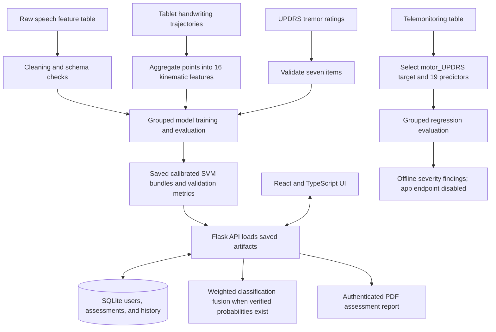

# Parkinson’s Detection System: Viva Guide

## 1. Project objective and scope

This project is a research prototype that studies Parkinson’s disease (PD) classification from three independent data types: speech measurements, handwriting movement, and clinician-rated tremor items. It also studies a separate regression task: estimating a continuous motor-UPDRS score from telemonitoring voice measurements.

The classifier outputs are experimental probabilities. The data are small, the three classification cohorts do not contain the same people, and there is no external clinical validation. The app is **not a diagnostic device** and must not be used to make medical decisions.

## 2. Architecture and data flow



The production-style web workflow has a React/TypeScript frontend and a Flask JSON API. Flask registers authentication, assessment, health, speech, spiral, tremor, history, and result routes in `app_backend/__init__.py`. The model registry loads fitted Joblib bundles from `experiments/regularized_svm_rf/results/artifacts/`; it does not train models at request time. SQLite stores user accounts, assessment steps, completed results, and history.

The API has a Vite development proxy for `/api`; the frontend can also use `VITE_API_URL` to address Flask directly. Flask CORS is enabled for API routes. The actual route map can be printed with:

```powershell
python -c "from app_backend import create_app; print(create_app({'TESTING': True}).url_map)"
```

The current registered paths include `GET /`, `GET /api`, `GET /api/health`, authenticated `POST /api/assessments/<id>/tremor/predict`, `POST /api/assessments/<id>/spiral/predict`, `POST /api/assessments/<id>/speech/predict`, history endpoints, and authenticated `GET /api/assessments/<id>/report.pdf`.

## 3. Datasets and input features

| Task | Available data | Target and model inputs |
|---|---|---|
| Speech classification | 240 recordings from 80 participants | Binary `status`; 45 inputs: numeric `gender` and 44 precomputed acoustic descriptors, including jitter, shimmer, HNR, RPDE, DFA, PPE, GNE, MFCC, and delta features. |
| Handwriting classification | 322,969 ordered tablet rows, aggregated to 110 participant/test records from 40 participants | Binary label; 16 kinematic summaries: point count, path length, velocity, acceleration, jerk, pressure statistics, grip-angle variation, duration, pen-up fraction, spatial variation, and bounding-box size. |
| Tremor classification | 130 participants (100 controls and 30 PD) | Binary label; seven numeric UPDRS III item 20/21 ratings: head and four limbs at rest, plus right/left upper-limb action or postural tremor. |
| Telemonitoring regression | 5,875 repeated measurements from 42 subjects | Continuous `motor_UPDRS`; 19 voice, demographic, and test-time predictors. Subject ID and `total_UPDRS` are excluded from the inputs. |

The tremor classifier requires seven integer ratings from 0 through 4. It does not infer those ratings from a video or self-reported tremor severity.

The speech dataset already contains acoustic features. `cleaningPipeline/speech_cleaning.py` cleans those tables; it does not compute them from raw audio. The app now extracts a separate experimental `speech_audio_v2` schema from PCM WAV and offers sustained-vowel and reading modes. Its recipe and limitations are in `experiments/speech_audio_v2/README.md`. It is not compatible with the saved 45-column SVM. No labeled raw WAV recordings are present, so there is no trained v2 speech model and the API returns HTTP 503 after extraction rather than a probability.

The handwriting training rows come from digitizer trajectories with x/y/z, pressure, grip angle, timestamp, point order, and test ID. `featureEngineering/handwriting_features.py` is the shared training-time feature extractor. The canvas now has a local telemetry proof of concept: it records coordinates, event times, stroke boundaries, and browser pressure/tilt when observed; it derives pixel-based path, speed, acceleration, jerk, and pauses. Those canvas values are approximate, are not persisted, and are not sent to the saved model. Browser pressure is not calibrated like tablet pressure, pen tilt is not grip angle, and stroke boundaries do not reproduce the training `z` sensor. The authenticated model route remains usable only with complete measured tablet telemetry. Ordinary camera images/video do not supply equivalent validated signals either.

## 4. Classification models and measured results

The current tuned deployment bundles are calibrated RBF Support Vector Machines (SVMs):

| Modality | Saved app artifact | SVM parameters | Held-out group-fold metrics: accuracy / precision / recall / F1 / ROC-AUC |
|---|---|---|---|
| Speech | `speech_svm_tuned.joblib` | C=1.0, gamma=0.01 | 0.7604 / 0.7778 / 0.7292 / 0.7527 / 0.8238 |
| Handwriting | `handwriting_svm_tuned.joblib` | C=0.1, gamma=0.01 | 0.9467 / 0.9661 / 0.9661 / 0.9661 / 0.9322 |
| Tremor | `tremor_svm_tuned.joblib` | C=1.0, gamma=0.1 | 0.8269 / 0.6667 / 0.5000 / 0.5714 / 0.8997 |

These are the tuned-SVM rows in `experiments/regularized_svm_rf/results/TUNING_REPORT.md`, measured on the held-out outer groups from folds 2–5. Fold 1 was set aside for fusion-weight estimation. The experiment also evaluates Random Forest models. Their ROC-AUC values were 0.8130 (speech), 0.9460 (handwriting), and 0.8427 (tremor). The app’s selected deployment bundles are the SVM models, not the per-fold “nested selected SVM/RF” row. In particular, that mixed selection row reports handwriting ROC-AUC 0.9460; it is not the SVM-only value shown above.

The bundles contain the fitted preprocessing and probability-calibration pipeline plus the expected feature order. The classifier adapter checks the input column order, class order, probability shape, and finite normalized output. A probability is a model score for the PD class, not a certainty or a diagnosis.

**What can currently produce a real app prediction:** tremor, from the exact seven UPDRS inputs. Handwriting can run the saved model only from complete measured tablet telemetry; the current mouse/touch canvas cannot. Speech audio is extracted with the separate v2 schema, but it cannot be classified until mode-specific labeled WAV data is used to train its model. No speech probability is generated in the current repository.

The repository also contains older baseline pipeline code and artifacts. `models/classification.py` defines SVM, Random Forest, and Gradient Boosting classifiers; `models/telemonitoring.py` defines Ridge, Random Forest, Gradient Boosting, and SVR. Those definitions do not mean every model is deployed. The current app loads the three tuned SVM classification bundles. XGBoost is not used.

## 5. Decision-level fusion

When verified modality probabilities exist, the app combines them using a weighted sum:

```text
P(combined) = sum(weight[modality] * probability[modality])
```

The validation weights in `experiments/regularized_svm_rf/results/fusion_validation_weights.json` are:

| Modality | Weight |
|---|---:|
| Speech | 0.350142 |
| Handwriting | 0.336668 |
| Tremor | 0.313190 |
| **Total** | **1.000000** |

They are normalized from AUCs on reserved group-validation fold 1. When a modality is unavailable, `src.fusion.fuse_probabilities` drops it and renormalizes the remaining eligible weights to sum to one. The assessment workflow does not accept a client-invented probability. It can complete once at least one verified model prediction is available.

The three cohorts have unmatched participants. These weights express validation-fold modality reliability; they do **not** establish patient-level multimodal accuracy, nor has a fused patient-level metric been measured. The existing UI/API marks that limitation in assessment results.

## 6. Motor-UPDRS severity regression

The continuous target is `motor_UPDRS` from the telemonitoring data. The evaluated predictors are 19 numeric columns, excluding `subject_number`, the target, and `total_UPDRS`. Five-fold `GroupKFold` keeps each subject entirely in one fold. Each held-out prediction is compared with the mean target value of that fold’s training subjects as the baseline.

| Model | MAE | RMSE | R² |
|---|---:|---:|---:|
| Ridge (alpha=10) | 7.656 | 9.089 | -0.250 |
| Random Forest | 8.096 | 9.841 | -0.466 |
| Training-fold group-mean baseline | 7.187 | 8.316 | -0.047 |

Both candidate regressors do worse than the group-mean baseline on these grouped results. Negative R² means their predictions are worse than the reference mean predictor under this evaluation. So the app does not expose severity estimates as reliable outputs. The database/UI keep classification probability separate from severity, and no regression ensemble is used. The tremor demographics file has no compatible continuous UPDRS target for a second tremor regressor, so there is no defensible severity ensemble to combine.

## 7. Training, preprocessing, and leakage precautions

The reproducible main pipeline is `python scripts/run_all.py`; the separate tuned classification experiment is `python experiments/regularized_svm_rf/run_experiments.py`. The tuned experiment uses five-fold `StratifiedGroupKFold` outer splits (seed 42), four-fold grouped inner search by ROC-AUC, and three group-aware calibration folds. The reserved fusion fold is excluded from the modality test metrics. SVM pipelines use median imputation and standardization; Random Forest pipelines use median imputation without scaling. These transformations and calibration are fit only inside the relevant training folds.

The speech group key is participant `id`, handwriting is grouped by participant and exact duplicate-feature components, and tremor by participant code. Telemonitoring uses `subject_number`. Handwriting has repeated test rows per participant and exact duplicate feature signatures shared by participants (seven control records and two PD records in the audited clusters); duplicate-connected participants are kept in a single fold. Participant IDs, test IDs, and target labels are not classifier predictors. These choices reduce leakage, but do not remove small-sample uncertainty or the need for outside validation.

## 8. Metrics in plain language

- **Accuracy:** fraction of all predictions that were correct.
- **Precision:** among cases predicted as PD, fraction that were actually PD.
- **Recall (sensitivity):** among actual PD cases, fraction the model found.
- **F1:** one score combining precision and recall using their harmonic mean.
- **ROC-AUC:** how well scores rank a randomly chosen PD example above a control across thresholds; 0.5 is chance ranking, 1 is perfect ranking. It does not establish clinical usefulness or calibrated risk.
- **MAE:** average absolute error in motor-UPDRS points; lower is better.
- **RMSE:** square root of mean squared error, in target points; it penalizes large errors more than MAE.
- **R²:** score relative to predicting a mean target; 1 is perfect, 0 matches the reference mean, and a negative value is worse than that reference under the evaluation.

## 9. Web app, persistence, and report flow

The frontend provides registration/login, a dashboard, assessment input pages, results, and history. The Flask API authenticates protected assessment routes with signed HMAC-SHA256 tokens and hashes passwords with Werkzeug. Its configured SQLite database defaults to `data/parkinson_app.db`; records are scoped to the authenticated user. History is available from `/api/history/assessments` and `/api/history/completed`.

The PDF action downloads `/api/assessments/<id>/report.pdf` with the user’s bearer token. The PDF is created by ReportLab and includes available step results, fusion details, methods, and research disclaimers. Reports do not imply that blocked inputs were classified. The UI remains sage-green and keeps research/medical disclaimers.

Speech and spiral statuses are explicit: speech extraction runs, then returns 503 until a mode-specific v2 model is trained; browser canvas coordinates alone return 422 because tablet pressure/grip inputs are absent. A validated tremor classification can complete an assessment by itself, in which case fusion uses the tremor weight renormalized to 1.0.

## 10. Glossary and limitations

- **Artifact:** saved, fitted model plus its preprocessing/feature schema, loaded by the backend.
- **Calibration:** adjustment of classifier scores to produce probabilities; it does not make a model clinically validated.
- **Digitizer telemetry:** measured tablet pen position and sensor signals such as pressure, grip angle, and pen-up state.
- **Late/decision-level fusion:** combine separate model outputs after each model has predicted.
- **Motor UPDRS:** clinician-rated movement-disorder scale; this project’s regression target is the motor score.
- **Subject-disjoint split:** no participant contributes rows to both training and test folds.
- **OOF:** out-of-fold prediction made for a row by a model that did not train on that row’s fold.

Main limitations are small and unmatched cohorts, no external/clinical validation, no speech waveform feature extractor, no tablet sensors on a standard canvas, modest tremor recall, and poor severity regression versus baseline. Good next steps are to collect a matched cohort with consent, add a validated tablet/audio acquisition pipeline with unit and feature-schema tests, evaluate on an independent subject cohort, report uncertainty and subgroup performance, and only revisit severity models after stronger grouped validation.
